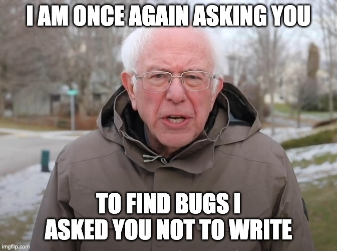

AI can generate a lot of code quickly.  There's a thought that we can catch its mistakes  or other issues by reviewing that code.  In theory, this may be true; code review *can* catch bugs.  In practice, it only works if the reviewer knows what to look for, has some context and, well, gives a shit.

<!-- more -->

<aside class="please-be-aware">

This is all in a <em>professional context</em>, i.e. at a job.  I don't think the conclusions here are necessarily relevant to hobby or open source projects.

</aside>

## Why Review Code at all?

In my experience, pre-AI, code review serves three purposes:

* Find bugs or undesirable qualities of the code before it goes to production.
* Provide a mentorship mechanism for less-experienced staff to learn (either about coding in general or the codebase in particular).
* Understand and approve changes going to production.

It's unclear how effective code review is at any of this.  It doesn't seem like hte *best* way to achieve any of these goals.  But, we do it because there is a low opportunity cost: we just start reviewing the changes.  It does *feel* wrong to let code go into production without someone else looking at it (in regulated environments, there *has* to be a second set of eyes).

<aside class="pullquote">
Code review has a huge carrying cost
</aside>

But, code review has a huge carrying cost. As a team gets larger, delivery can slow down while changes wait for code review.  Experienced or tenured developers can find themselves spending more time on code review than writing code.

If [AI is writing the code](/blog/2026/10/19/why-even-write-code-in-a-professional-context.html), there's even less reason to spend the
time doing code review.

## Reviewing AI Code is All Carrying Cost and No Benefit

The AI code-generator isn't going to improve or change its coding behavior based on the output of a code review.  While you could certainly include all code reviews in the context for the AI that is not going to be as effective as simply telling it directly what to do (which is itself less effective than providing a tool that gives a yes/no answer).

<figure class="small-figure left">
  
</figure>

In terms of understand & approving what goes to production, code review isn't a great way to do that.  In my experience, any compliance
review is looking at the change description and, at best, if there are any tests.  No compliance team is looking at line-by-line changes.

This leaves only one purpose for reviewing AI generated code: finding bugs or other undesirable qualities (e.g. violating architectural conventions). The benefits here are unknown at best.  It may *feel* like its worth it to review the AI-generated code for bugs, but it's unlikely that an experienced developer would find many.

<aside class="pullquote">
Over time, there <em>won't</em> be any experienced developers
</aside>

But, over time, there *won't* be any experienced developers.  The skills would atrophy across the team and the sheer mind-numbing nature of
doing nothing but reviewing AI-generated code would further erode any lingering effectiveness.

But even if we could somehow maintain the skills to properly review AI-generated code, such a process would need to be managed far more
directly than we do now.  How does the team's manager know if the reviews are working?  Since code review [is meta-work](/blog/2018/01/19/work-vs-meta-work-delivering-the-right-results.html) and not a result unto itself, there's little intrinsic motivation for anyone to do it or do it well.  And thus, a gameable management system for human code review would be born.

## Just Add More AI

Some teams have the AI review the code.  Like human code review, this is a low opportunity cost activity: just ask the AI to do the review, then feed the output back to either the same AI or another one to make changes. This would certainly have a lower carrying cost than having people do it, but it's hard to think it would be any more effective.

Just like a hypothetical developers-that-only-review-AI-generated-code process must be closely managed, so, too, would the AI version of it. [The AI has no intrinsic motivation](/blog/2026/10/21/you-cannot-trust-the-ai-code-generator.html) to properly navigate ambiguity in the way we want. There would need to be some way to know that the AI code reviews were actually working.

Would such a process really be that effective? Since the AI cannot improve, nor could it approve of changes in a regulatory environment, this
leaves again only one point of the code review: finding bugs.

<figure class="small-figure right">
  
</figure>

If the AI is creating bugs that the reviewer AI is able to find, that doesn't exactly prove the efficacy of the code reviewer, but a
deficiency in the code generator.  Whatever prompt you give to the code reviewer, shouldn't you simply give that to the code writer?

Automating a human-powered task by replacing the humans with robots is a narrow view of the system.  Why not get rid of code reviewer entirely, and spend those tokens creating custom static analysis tools?

## Spend Time and Energy on Tooling

Considering the time and cost of having an AI perform code reviews, it shouldn't take many of those reviews to code more than developing
customized analysis tools to more definitively check for the desired outcomes.  This sort of thing has a high opportunity cost and a non-zero
carrying cost, historically.  Given how cheaply such tools could be  made now, it's pretty worth it.

<figure>
    

        <table> 
            <thead>
                <tr>
                    <th scope="col">Goal</th>
                    <th scope="col">Technique(s)</th>
                </tr>
            </thead>
            <tbody>
                <tr>
                    <th scope="row">
                        Bugs / Standards
                        <small>Reducing errors, improving compliance with architectural and coding conventions</small>
                    </th>
                    <td>Static analysis, prompt refinement</td>
                </tr>
                <tr>
                    <th scope="row">
                        Mentoring
                        <small>Improving generated code</small>
                    </th>
                    <td>Prompt refinement</td>
                </tr>
                <tr>
                    <th scope="row">
                      Approvals
                      <small>Regulatory or other process-required human approval of changes</small>
                    </th>
                    <td>Static Analysis, Human approval of change requests (not code)</td>
                </tr>
            </tbody>
        </table>
    

    <figcaption>Alternatives to Code Review When AI Writes the Code</figcaption>
</figure>

This also leads to a hopefully virtuous cycle of improving the entire process.  An AI code generator is given a prompt and a static analysis
tool to check its work.  It produces a change request for humans, that allows for compliance review, and a set of code changes.  Those code
changes could be fed into another static analysis tool, if it makes sense to do this after a change has been proposed.

After that, code goes to production.  Errors that happen trigger a human review that may result in improving prompts or refining the static
analysis tools.

<figure>
{% inline_svg images/review-process-ai.svg "A complex workflow that starts with a 'Prompt' and 'Static Analysis' blocks, that feed into an 'AI Code Generator'.  This produces a 'Change Request consumable by humans' and 'Code Changes'.  The former is sent to a 'Compliance Review (if required)', with the latter to a 'Post-Code Static Analyzer (if needed)'.  Both of THOSE feed into 'Production'. From 'Production' is an edge 'production errors' that goes into 'Human-driven Analysis of Production Errors', which then feeds into 'Prompt', 'Static Analysis', and 'Post-Code Static Analyzer (if needed)', with each edge labeled 'refine'." %}
<figcaption>
AI-driven coding with alternative tools to code review.
</figcaption>
</figure>

This may seem complicated or too hypothetical, but replacing a questionable human process with AI isn't the best approach.  Code reviews
don't magically get better just by doing them faster with AI.  If we are willing to "do stuff faster with AI", it's a far better approach to
actually prioritize static analysis tools the team would never have previously spent time on.  This also gives you a measurable system that
makes it clear what part of the process is working, and a clear way to improve it.

Interestingly, with this in place, you *could* add in an AI code reviewer and actually measure its efficacy.  But simply replacing a human
task with an AI one and assuming it will be better doesn't make sense if you have no way to actually understand how the AI is working. A
human could be trusted to do a good job. The AI cannot be.
